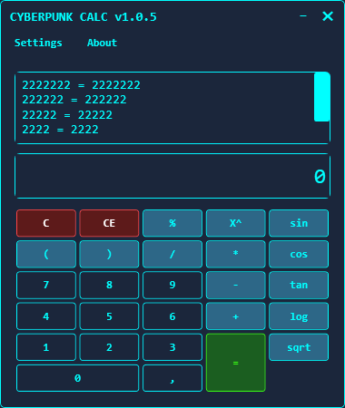

# CyberCalc.NET9

  <a href="https://zerodayz7.github.io/CyberCalc.NET9/">Official Website</a>
  ·
  <a href="https://github.com/ZeroDayZ7/CyberCalc.NET9/releases/latest">Latest Release</a>

  
  
  

**A calculator born from a Windows Registry mishap.**

While tinkering with the Windows Registry, I accidentally broke the original Windows Calculator. So I built my own. And since I needed a calculation history, I made sure CyberCalc had one. Turns out, it became a much bigger project than expected. 😉

Originally based on the classic WPF-CALC, CyberCalc.NET9 has been modernized and migrated from .NET Framework to .NET 9.

## Features

| Feature | Description |
|---|---|
| **Calculation Engine** | Basic and advanced mathematical operations |
| **Math Functions** | `sin`, `cos`, `tan`, `log`, `sqrt` |
| **Operation History** | Keep recent calculations within reach |
| **Keyboard Shortcuts** | Calculate without reaching for the mouse |
| **Error Handling** | Clear handling of invalid operations and input |
| **Multiple Themes** | Cyberpunk, Dark, Light and Legacy |

## 🖥️ Interface

  

  <a href="https://zerodayz7.github.io/CyberCalc.NET9/">Official Website</a> ·
  <a href="https://github.com/ZeroDayZ7/CyberCalc.NET9/releases/latest">Download</a> ·
  <a href="https://github.com/ZeroDayZ7/CyberCalc.NET9/issues">Report an Issue</a>

  Created by <a href="https://github.com/ZeroDayZ7">ZeroDayZ7</a> · © 2026

